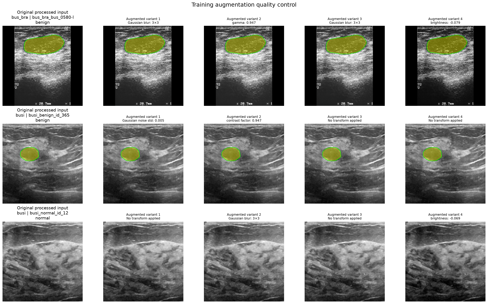

# Augmentation experiments

This report tracks augmentation experiments against the frozen
[ERM baseline](baseline.md). Each comparison uses the same data split,
architecture, preprocessing, optimizer settings, checkpoint-selection rule,
and training seeds (`42`, `123`, and `456`). Checkpoints are selected using
source validation only; BUS-UCLM is used to assess OOD development
performance. BrEaST remains excluded from model development.

Metric definitions and aggregation rules are documented in the
[evaluation metrics guide](../evaluation/metrics.md). Values below are mean ±
sample standard deviation across the three seeds.

## Experiment summary

| Experiment | Change from reference | Macro source lesion Dice | OOD lesion Dice | OOD recall | OOD miss rate | OOD normal FP fraction / image rate | Decision |
|---|---|---:|---:|---:|---:|---:|---|
| `baseline_multisource_tuned_v2` | No augmentation | 0.8249 ± 0.0032 | 0.7149 ± 0.0277 | 0.7127 ± 0.0271 | 5.26 ± 2.91% | 1.93 ± 0.21% / 50.73 ± 12.89% | Frozen reference |
| `erm_multisource_geometric_v1` | Conservative geometric augmentation | **0.8374 ± 0.0068** | **0.7206 ± 0.0124** | **0.7434 ± 0.0288** | 6.03 ± 1.11% | 2.36 ± 0.26% / **47.56 ± 4.80%** | Promising, but not adopted as the reference |
| `erm_multisource_intensity_v1` | Conservative intensity augmentation | 0.8239 ± 0.0027 | 0.6992 ± 0.0157 | 0.6957 ± 0.0503 | 5.64 ± 5.02% | 2.39 ± 2.14% / 55.93 ± 27.78% | Not adopted |

The table intentionally emphasizes the primary lesion metric and the main
failure modes. All-image Dice is not used to rank augmentation variants
because it is strongly affected by the proportion of normal scans.

## Geometric V1

Configuration:
[`erm_multisource_geometric_v1.yaml`](../../src/ultrasound_dg/configs/experiments/augmentations/erm_multisource_geometric_v1.yaml)

The training pipeline applied a horizontal flip with probability `0.5` and,
independently, selected a geometric branch with probability `0.5`. The branch
was either `SafeRotate` up to ±7° or an affine transform combining translation
up to 2% with scaling between `0.94` and `1.0`. The same spatial transform was
applied to each image and its mask.

Visual and automated quality checks confirmed image-mask alignment, binary
masks, unchanged empty masks, and no completely removed lesion masks. Rotation
can reduce apparent lesion size because `SafeRotate` shrinks image content to
avoid cropping; this is an accepted property of this first variant.

Compared with the reference baseline:

- macro source lesion Dice increased by `0.0125`, with improvement in all three
  paired seed runs;
- the largest source improvement occurred on BUSI (`0.7578` to `0.7788`);
- mean OOD lesion Dice increased by only `0.0057`, and the paired change varied
  across seeds (`+0.0405`, `+0.0140`, and `-0.0373`);
- OOD recall increased by `0.0307`, but precision decreased by `0.0141`;
- OOD false-positive area increased from `1.93%` to `2.36%`, despite a small
  reduction in the proportion of normal images exceeding the FP threshold;
- patient-macro OOD lesion Dice changed from `0.6958 ± 0.0294` to
  `0.7027 ± 0.0134`.

The augmentation therefore improves source-domain generalization, especially
on BUSI, and reduces the variance of several OOD metrics. Its average OOD Dice
gain is nevertheless small and not consistent across seeds, while the larger
false-positive area indicates more aggressive predictions. Geometric V1 is
retained as a useful augmentation component, but the no-augmentation ERM model
remains the reference until a later augmentation pipeline shows a clearer and
better-balanced OOD improvement.

## Intensity V1

Configuration:
[`erm_multisource_intensity_v1.yaml`](../../src/ultrasound_dg/configs/experiments/augmentations/erm_multisource_intensity_v1.yaml)

Intensity V1 isolates appearance augmentation from geometric augmentation. For
each training sample, there is a `0.5` probability of selecting one mild
operation: brightness or contrast adjustment up to ±10%, gamma in the range
`0.9–1.1`, Gaussian noise with standard deviation up to `0.02`, or Gaussian
blur using a `3×3` kernel and sigma up to `1.0`. The operation is applied after
grayscale conversion in the `[0,1]` intensity range and before channel
replication and ImageNet normalization. The mask is not passed to the intensity
transform and therefore remains unchanged.

*Figure 1. Representative Intensity V1 samples from BUS-BRA and BUSI. Each row
shows the processed reference followed by four independently sampled variants.
Seed 4 was used for this quality-control figure because the resulting grid
covers every configured operation; it has no role in training or model
selection.*

Manual inspection found that:

- image geometry and mask position remain unchanged across all variants;
- the `3×3` blur and sampled Gaussian noise remain subtle and preserve lesion
  boundaries and larger anatomical structures;
- gamma and contrast transformations introduce visible but mild tonal changes;
- the strongest displayed brightness reductions make scans darker without
  obscuring the lesion or surrounding tissue;
- the normal BUSI example remains anatomically plausible and retains an empty
  mask;
- no obvious clipping, saturation, or augmentation-induced artifact was
  observed in the reviewed examples.

The policy passed visual quality control, but its three-seed results did not
show a generalization benefit over the reference baseline:

- macro source lesion Dice remained effectively unchanged (`0.8249` to
  `0.8239`), indicating that the augmentation did not materially affect
  source-domain performance;
- mean OOD lesion Dice decreased by `0.0157` (`0.7149` to `0.6992`), with
  paired seed changes of `+0.0271`, `-0.0286`, and `-0.0454`;
- OOD recall decreased by `0.0170`, while lesion precision decreased by
  `0.0070`;
- patient-macro OOD lesion Dice decreased from `0.6958 ± 0.0294` to
  `0.6804 ± 0.0191`;
- mean OOD normal false-positive area increased from `1.93%` to `2.39%`, and
  the image-level false-positive rate increased from `50.73%` to `55.93%`;
- false-positive behaviour was particularly unstable: seed `456` produced a
  `4.85%` mean false-positive area and false positives above the threshold on
  `87.80%` of normal BUS-UCLM images.

The zero lesion miss rate for seed `456` does not indicate an unambiguously
better model: it coincided with the most aggressive false-positive behaviour
and the lowest precision among the three runs. Across seeds, the isolated
Intensity V1 policy therefore provides no reliable OOD improvement and is not
adopted for the next pipeline. The implementation and visual inspection are
retained as evidence; a future intensity policy should be reformulated or
tested only as a separately justified experiment.

